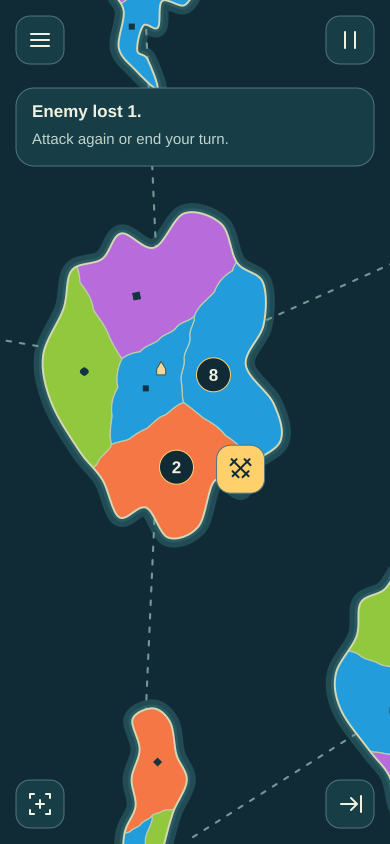
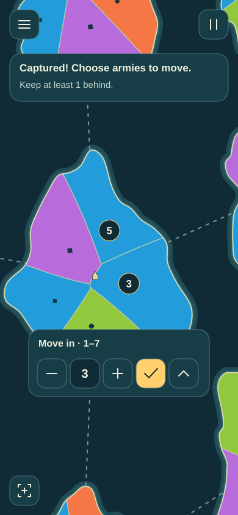
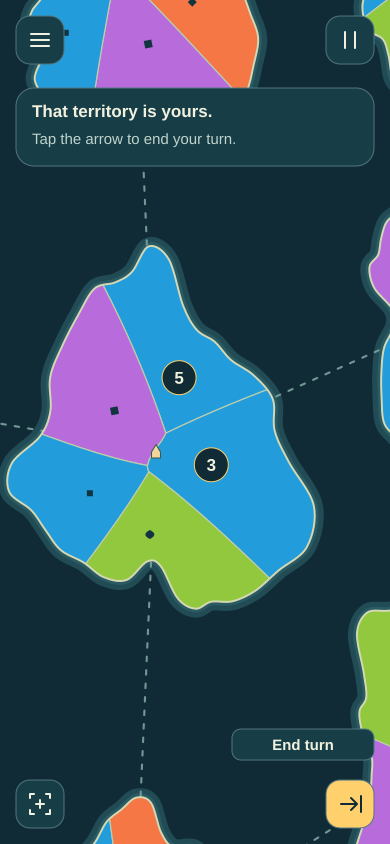
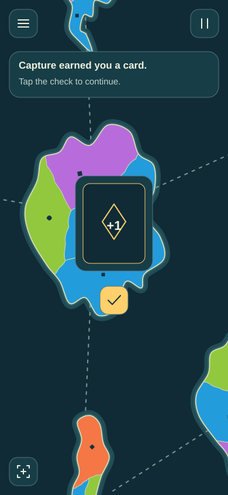

# A beginner's first turn

These are **proposed first-use screens**, not a played match or implemented
tutorial. They keep the map and icon controls, adding one short explanation at
the moment it helps. The beginner learns by acting, not by memorising a legend.
Experienced players can skip tips; Help can replay them. This is a teaching
proposal for review, not a new implementation dispatch or approved tutorial task.

The brighter palette uses consistent blue, orange, green and purple ownership,
with shape marks as a second cue. Irregular coasts, curved borders and varied
partitions give the map more character. Colour continues to identify the owner;
it is not random terrain decoration.

## The illustrated sequence

| First action | The response and next decision |
| --- | --- |
|  | **1. Start.** The goal and useful default are explained briefly. The play icon is named **Start game**, so the beginner does not have to guess. Seed, seats and rules are available through options without requiring configuration first. |
|  | **2. Place.** A short hint identifies blue as the player's colour. Tapping a blue territory adds one army. This zoomed example shows the last army remaining: **7 → 8**. Initial income and earlier placements are not asserted by this sample. The first navigation hint can explain pinch/drag; Fit and the country list remain alternatives. |
|  | **3. Start combat.** When placement is complete, the next legal phase action is named **Start combat**. The player explicitly enters combat. Showing only a generic arrow without naming its new purpose would be ambiguous. |
|  | **4. Select and attack.** Select the blue source, then a neighbouring orange enemy. Their counts explain the chosen pair. The highlighted swords icon is named by the current hint; activating it performs one exchange. Selection, a map gesture or opening help cannot roll dice. |
|  | **5. Read what changed.** This example loses one enemy army: **3 → 2**. The player can attack again or stop/end the turn. Dice can also reduce the player's armies. The guide must explain the actual result and continue from it, never force this example's win. |
|  | **6. Move into captured land.** After further successful exchanges, the captured territory turns blue. The required choice explains the amount and legal bounds; −/+ adjust it and the check confirms. Moving **3 total** from an army of 8 leaves **5 / 3**. At least one stays behind. The displayed counts preview the selected amount, not an already committed move. |
|  | **7. End the turn.** After confirming move-in, both territories are blue. The arrow is named **End turn** on first use. The player may keep playing legal actions instead; End turn cannot bypass a pending required choice. |
|  | **8. Receive the reward.** With cards enabled, a capturing turn earns a card. In this example the hand has room, so the reward asks for acknowledgment. The check continues play; mandatory discard/other cases need their own applicable guidance. Opponents continue after required choices finish. |

On later turns those explanations clear away, leaving the quiet map. Hints name
an unfamiliar action when it first becomes relevant. They reappear from Help on
request. Critical choices/errors never disappear on a timer. A touch hold or
keyboard focus can reveal any icon's name without activating it; screen readers
have that name directly. A hold/drag release must not accidentally become a tap.

## Four standing controls

- **Menu:** help/replay tips, cards, full totals/history, files and settings.
- **Pause:** stop or resume computer playback; speed remains in requested settings.
- **Fit/focus:** return to the overview or focus the requested selection; pinch to
  zoom and drag to pan when enlarged, with keyboard/list alternatives.
- **Current phase action:** enter combat or End turn only when legal. Its name is
  shown on first use or request; required choices replace that action.

The swords action appears for a staged legal enemy pair. Friendly movement,
Fight on/Stop and optional systems are introduced when they become relevant,
rather than teaching every capability in the first screen. Help still covers the
complete rules and consequences. No capability is removed to simplify this tour.

## Evidence and limits

The numbers and camera focus are illustrative. The sequence shows possible
consecutive successful exchanges, not a deterministic tutorial replay or guaranteed
combat result. Income/pool numbers, victory text, legal targets, card availability
and result hints must derive from the actual controller/options in a real build.

The transfer example follows the existing total-move-in protocol in
[combat.ts at the source baseline](https://github.com/diegoami/malpaco/blob/e8e3f908fbea8ed74e5cb26c03690a71e4c1f25d/src/core/combat.ts)
and T27: provisional occupation is part of the selected total, not an extra army.
The ordinary capture sketch now also previews **5 / 3**, replacing its older
illustrative **5 / 4**. No combat rule changes. Reward guidance follows the
existing cards/phase contracts; disabled cards or a full hand require the
corresponding real branch, not this sample notice.

Before calling the UI beginner-friendly, later playable acceptance should ask a
new player to start, identify their territory, place, select/attack, interpret a
loss, confirm capture and finish a turn without outside coaching. Check whether
they find help, recover from a wrong selection, return from zoom and understand
what changed when the text clears. Static images cannot establish that result.

Regenerate with `python3 docs/plans/finished-game-vision/draw-beginner-walkthrough.py`.
