# Learn through the next useful action

Revision 7 applies the requested changes in twenty-three focused illustration frames.
These are proposed first-use moments, not twenty-three screens to read before playing:
show only the hint for the current action, then clear it. Experienced players can
skip tips and replay them through Help. Army numbers in owner-shaped badges
remain visible at rest; prose stays temporary. The remaining placement pool stays
visible independently of hints. No tutorial code or product implementation is
dispatched by this package.

## Illustrated sequence

| Moment | What the player learns |
| --- | --- |
| 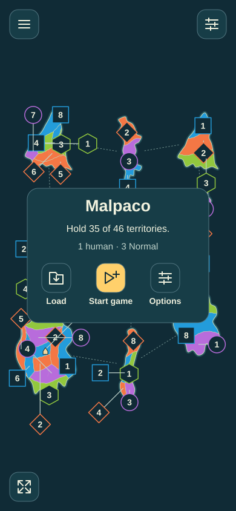 | **1. Start.** The approved default domination goal is briefly named: hold 35 of 46. Start game is named; options and load are requested separately. |
| 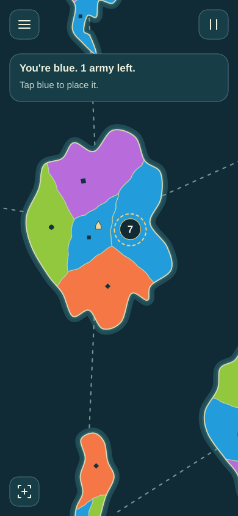 | **2. Place one army.** Blue square identifies the player. This is the last reinforcement: tapping adds one, 7 → 8. Inspection is a separate safe mode. |
| 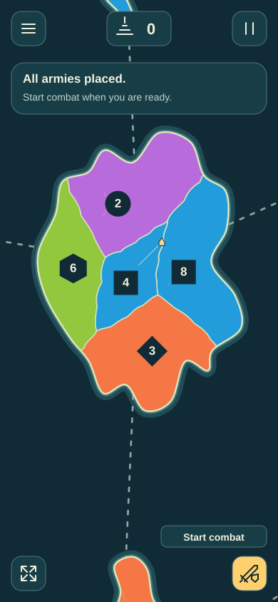 | **3. Start combat.** The named phase action becomes available after placement. It does not roll a battle. |
| 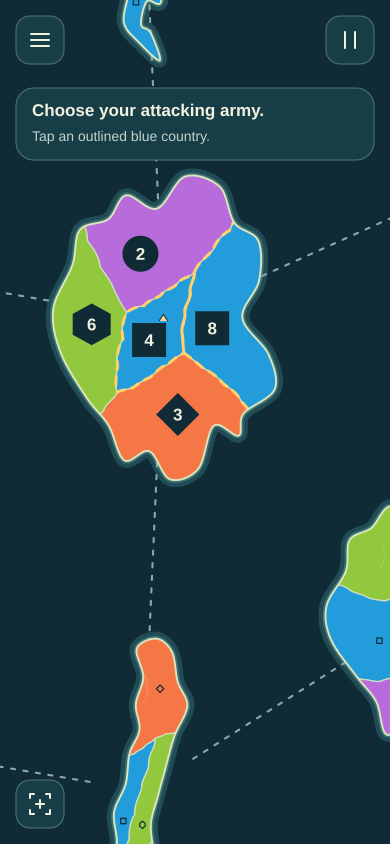 | **4. Choose a source.** Eligible own countries are outlined. The player chooses an army before selecting an enemy. |
| 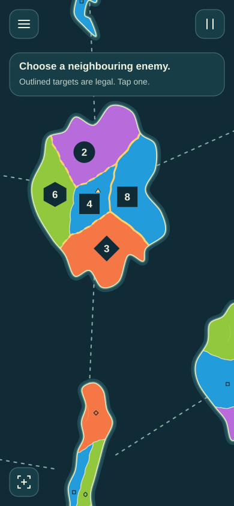 | **5. Compare targets.** The source immediately has a filled gold badge and thick solid emphasis; legal enemy neighbours are dashed and their stacks are visible together. Other countries dim but retain visible owner-shaped army numbers. |
| 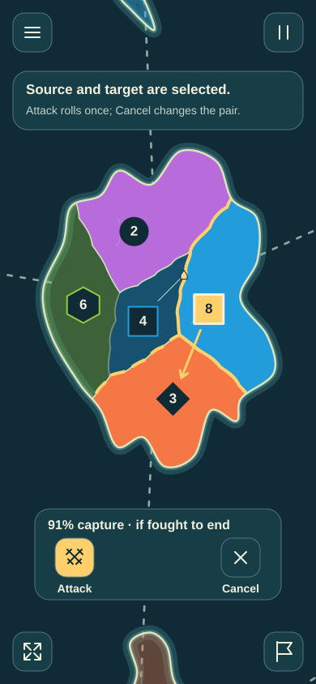 | **6. Read odds and Attack.** The selected 8-versus-3 pair shows 91% capture odds if fought to capture. Attack commits one exchange; Cancel clears the pair. Selection itself never rolls. |
| 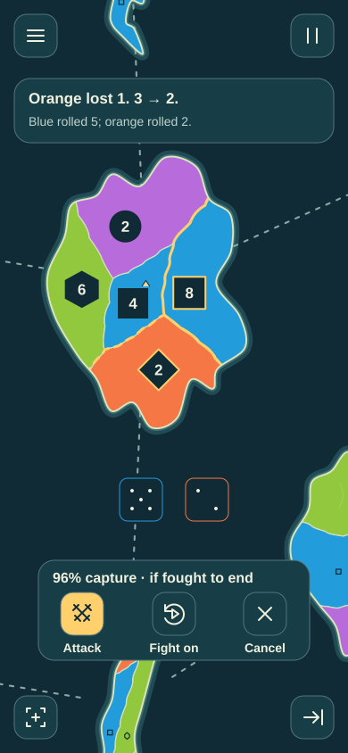 | **7. See an enemy loss.** Blue 5 against orange 2 removes an enemy army: 3 → 2. The 8-versus-2 capture chance is now 96%. Short feedback clears; the result remains recoverable in history. |
|  | **8. See a human loss.** Blue 1 against orange 6 removes a blue army: 8 → 7. The 7-versus-2 capture chance is now 94%. This teaches that another Attack can cost armies. |
| 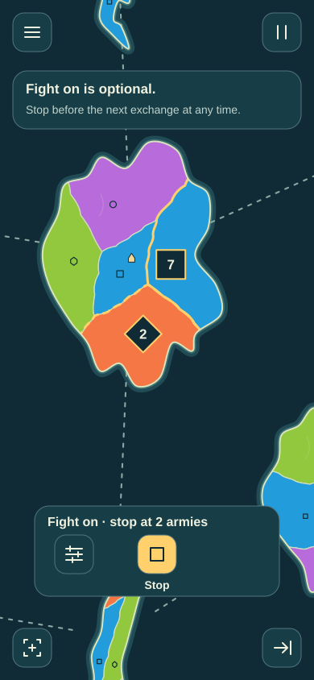 | **9. Optional Fight on.** After explicit Attack on this unchanged pair, Fight on can continue to the chosen stop-at amount. Stop remains live before the next exchange; speed changes presentation only. |
| 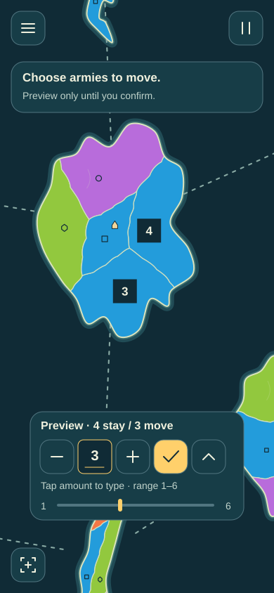 | **10. Preview move-in.** After further successful exchanges with seven surviving source armies, moving a total of 3 previews 4 / 3. Range 1–6 keeps one behind. Tap the amount to type, use minus/plus or range adjustment; Check commits. |
| 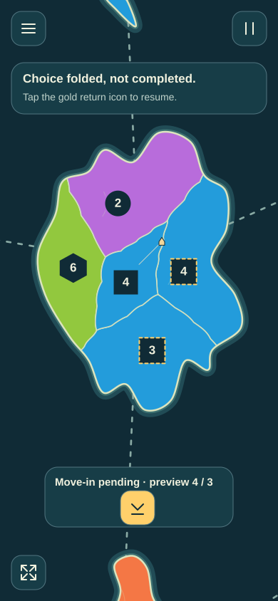 | **11. Fold a required choice.** A distinct gold return icon retains the pending 3 and 4 / 3 preview. Folding does not confirm or allow unrelated game actions. |
| 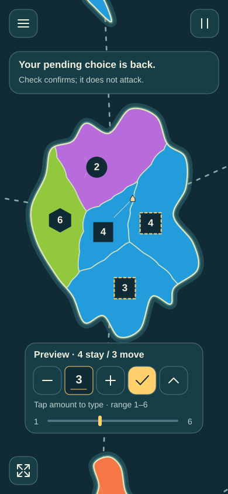 | **12. Return and confirm.** The return icon restores the same draft and choice. Only Check confirms it. Rotation, pause and reading must preserve it. |
| 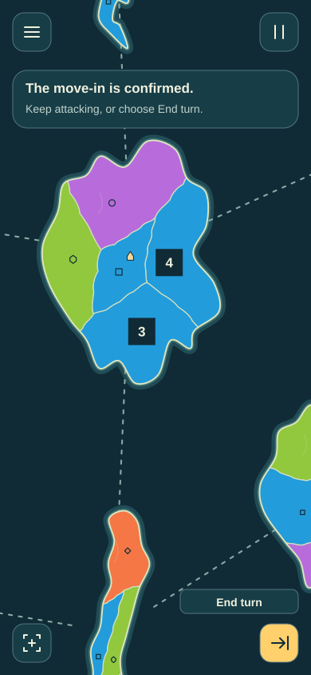 | **13. Choose End turn.** The capture allocation is committed. The player may continue legal actions or use the named End turn action. |
| 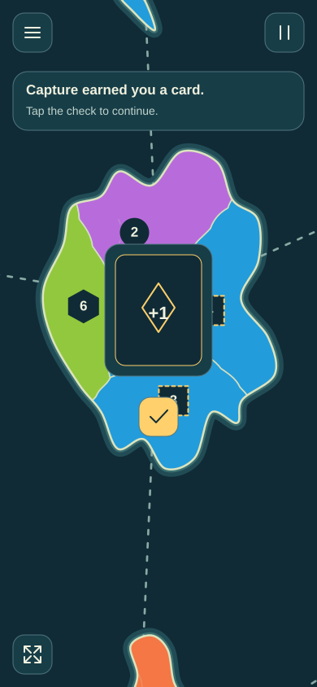 | **14. Acknowledge a reward.** With cards enabled and room in hand, a capturing turn shows its private reward and requires acknowledgment. Disabled/full-hand branches use their actual applicable choices. |
|  | **15. Follow an opponent.** An illustrative later opponent phase shows Purple reinforcing. Owner/phase identity, local +3, Pause and fast-forward explain what is happening without a fixed status bar. |
| 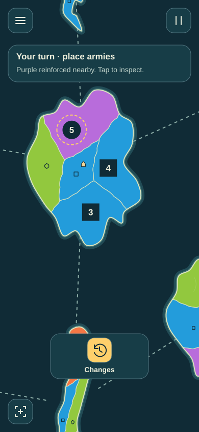 | **16. Recover what changed.** The next human turn offers Changes and local marks. The remaining pool is visible independently of this hint. Changes recovers relevant opponent actions before returning to placement. Hints and marks clear after interaction. |
| 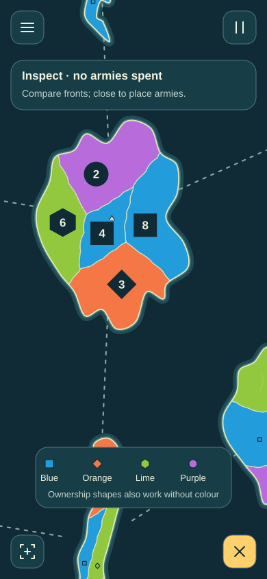 | **17. Compare without spending.** Army counts are already visible without inspection. Optional inspection adds identity, income/island detail and an owner-shape legend. It spends no reinforcement; Close restores Place 1. Other fronts can be focused/list-selected. |
| 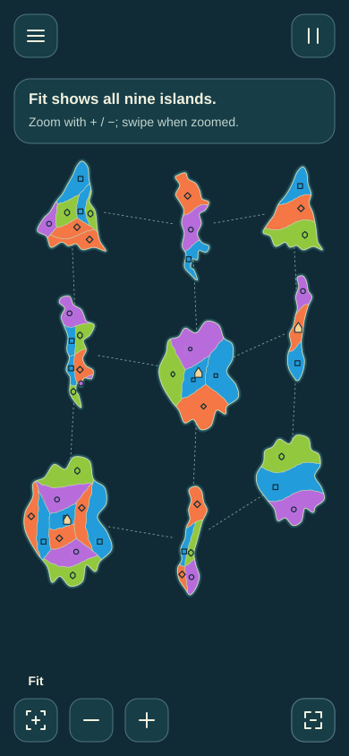 | **18. Find the whole map.** Fit always shows every island. Focus is separate; requested +/− controls and pinch zoom, while swiping pans only when zoomed. |
| 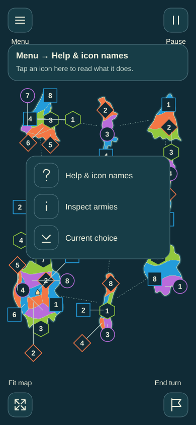 | **19. Find help and icon names.** Menu → Help & icon names provides a tap-accessible route. The requested labels explain controls; they do not activate them and disappear when dismissed. |
| 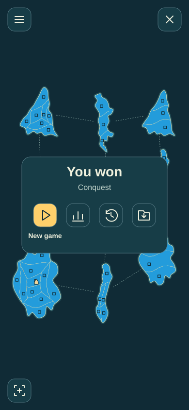 | **20. Start another match deliberately.** A default-domination result shows 35 blue countries, names the 35-of-46 win and New game. Standings/history/files remain requested details; dismissing preserves the final map and recoverable result. |
| 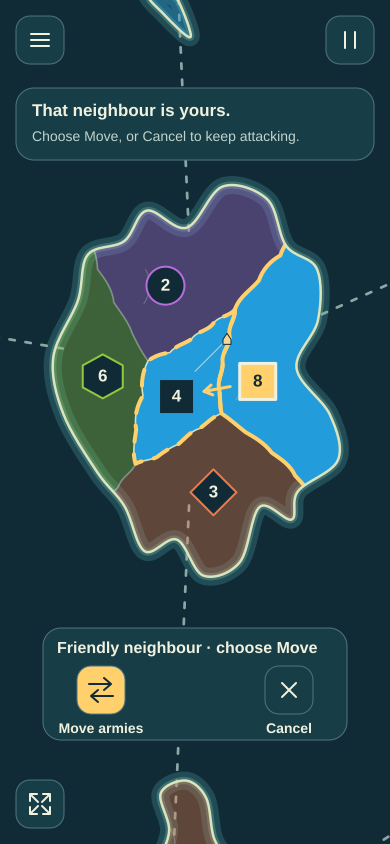 | **21. Friendly neighbour.** Tapping an own neighbour offers Move armies or Cancel; it does not attack or move automatically. |
| 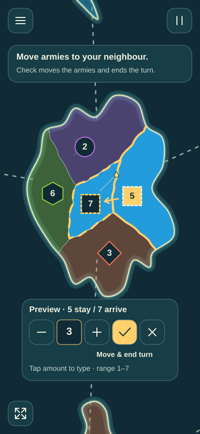 | **22. Move and end turn.** Source 8 and friendly destination 4 preview 5 / 7 for edited total 3. Check explicitly moves and ends the turn; Cancel returns to attacks without a change. |
| 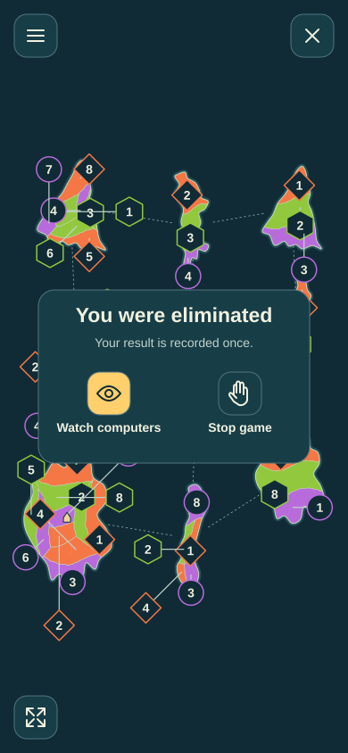 | **23. Elimination.** No territories remain for the human. Watch computers and Stop game are distinct choices; neither invents another human loss. |

## Interaction rules

The board has icon controls for Menu, Pause, Fit and the legal current phase
action. Their names appear on first use or request. Fit always shows the whole
archipelago; focus is separate. Menu exposes Help & icon names, army inspection,
current choice, cards, full totals/history, files and settings. Touch never relies
on hover or a hold alone. Holding/focusing an icon is an additional name route;
releasing a hold, drag or pinch must not accidentally activate it.

Source selection exposes neighbouring choices; only explicit Attack rolls an
exchange. Fight on requires that first Attack on the unchanged pair, and Stop
remains responsive. Capture previews are visibly pending, allow direct amount
entry and range adjustment, and remain recoverable after folding. Illegal
attempts explain the reason locally without changing state. No required choice,
error or privacy gate disappears on a timer.

Short local feedback, optional continued battle and opponent fast-forward keep
the direct map rhythm; original sound has equivalent visual feedback and reduced
motion retains the information. This is the requested Isle Wars Pro bias through
clear decisions and consequences, with original drawings and controls.

## Numbers and boundaries

The images are a possible interaction example, not a deterministic replay,
forced win or valid match fixture. After an enemy loss and a human loss, the
pictured source has 7 armies. Further successful exchanges can capture without
another source loss. Selecting a total of 3 then previews 4 / 3, with legal range
1–6. The edited 3 does not replace the controller's default. Provisional minimum
occupation is part of that total, never an extra army (T27).

The illustrative capture odds use the approved single fair die per side, ties
rerolled and one army left behind: 8 versus 3 = 233/256 (91% rounded), 8 versus 2
= 247/256 (96%), and 7 versus 2 = 15/16 (94%). These describe fighting to capture,
not the next exchange or Fight on's user-selected stopping condition. See
[the pinned combat source](https://github.com/diegoami/malpaco/blob/e8e3f908fbea8ed74e5cb26c03690a71e4c1f25d/src/core/combat.ts)
and [rule preset](https://github.com/diegoami/malpaco/blob/e8e3f908fbea8ed74e5cb26c03690a71e4c1f25d/src/core/state.ts).
Actual UI odds must derive from actual stacks/rules. Numbers, goal, phase,
reinforcement pool, legal targets, reward, owner/changes and result must all adapt
to the actual controller/options. The overview's schematic borders/routes do not
prove legality. The final result illustrates the default domination goal, consistently with setup. Navigation/help frames are additional
first-use examples, not assertions about the immediately preceding turn.

The four geography studies remain illustrative, not a closed generator catalogue.
Card trading/Raid, events and private handover remain text-only here; their full
contract obligations remain in the journey and existing tasks. These drawings do
not establish touch safety, accessibility, enjoyment or
beginner success. Those belong to separate review and playable D4 acceptance;
existing full-match/device/rule and artifact gates remain binding.

Regenerate with `python3 docs/plans/finished-game-vision/draw-beginner-walkthrough.py`.
