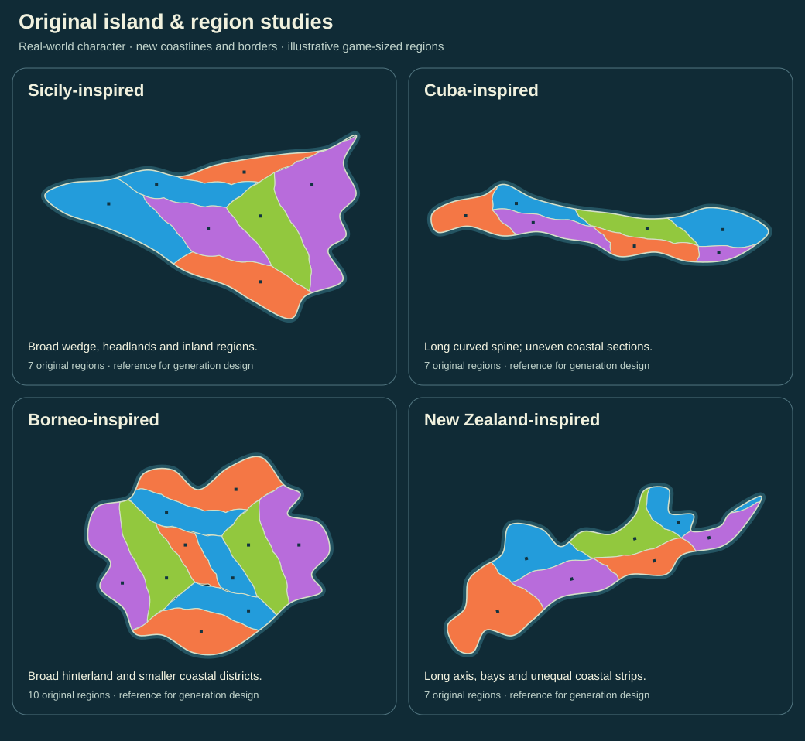

# Real island character, original game geography

Owner direction, 2026-10-20: include usability in the owner's review, and use
**Sicily, Cuba, Borneo, New Zealand and their provincial/regional structure as
generation references**, without copying them. This refines the already required
organic-map bar: distinctive overall shape and coherent regions matter together.

The current UI drawings now use original examples of these shape families. The
beginner teaching sequence remains the same. Usability is part of the owner's
review of actual builds; these drawings do not certify it.



## What the examples teach

| Reference | Character to study | Original design lesson / illustration |
| --- | --- | --- |
| Sicily | A broad wedge with distinct coastal ends and a substantial interior; compare coastal and inland administrative areas | A newly drawn tapered mass, headlands and bays, with interior and unequal coastal regions. The study has seven game-sized regions, not Sicily's actual province map. |
| Cuba | Long, curved island form; compare the arrangement of regions along its length | A bent axial form, uneven-width coastal sections and staggered divisions. The study has seven original regions, not actual Cuban provinces. |
| Borneo | Broad landmass and unequal regional extent; administrative levels include countries, states/provinces and smaller districts | A large hinterland, smaller coastal regions and two interior regions in the ten-region example. It does not reproduce real jurisdictions or claim all actual provinces are landlocked. |
| New Zealand | Elongated landforms, bays and axial mountain ranges; regional/district definitions differ | A newly drawn long island form with a narrow axis, unequal sides and coastal strips. The seven-region study is one original island, not a reproduction of the country or its two main islands. |

These are reference families rather than country skins. Exact coastlines, real
province boundaries, names, counts and political relationships are not game
requirements. Regions should vary in size and structure while retaining readable
ownership and legal movement. Administrative borders can reflect history and
settlement as well as rivers and mountains; do not claim every real border is a
physical watershed.

## Proposed generation brief for later reconciliation

- Give an island a large-scale structure: broad/wedge-shaped, long/curved,
  compact with a deep interior, or elongated with strong constrictions. Vary
  proportions, orientation, bays, headlands and coastal detail within a family.
- Design subdivisions with that structure. Some families support interior
  regions and broad hinterlands; others support uneven coastal chains or
  differently sized regions on either side of an axis. Avoid giving every
  island the same central junction and repeated perimeter cells.
- Treat terrain/spines/drainage as possible construction guidance, not automatic
  new combat rules or a requirement to draw mountains/rivers on the game screen.
- Co-design legal topology, land borders, coasts, route attachment and labels.
  Do not wrap an attractive outline around an incompatible graph or quietly
  relax approved degree, fairness, route or minimum-size constraints.
- Preserve the existing 46-country/nine-island/count/adjacency/fairness contract
  and versioned save/replay identity. These studies do not prove those combined
  constraints feasible or satisfied; the approved feasibility process remains.
- Compare retained representative seeds for family character, variation within
  families, region shape/size, connectivity, route clarity, phone focus/picking,
  generation cost and refusals. Set or amend measurable targets through the
  existing owner/task process after feasibility evidence, not by guessing them.

This is a visual-generation requirement to reconcile with #173/T64–T65, #181,
label work and acceptance, using their existing issues. No generator algorithm,
new engine, research run, task dispatch, release placement or publication is
selected here. The four studies and the updated overview are static original
drawings, not production-generation evidence or valid match fixtures.

## References consulted

Reviewed on 2026-10-20 for geographic/administrative context. Sources are linked;
no source images, geographic coordinates, border vectors or map data are imported,
traced or redistributed in this repository. All drawing points and subdivisions
were authored for these studies. The four names below are review annotations,
not product flavour names; flavour naming remains deferred.

- [Visit Sicily: A journey to the heart of the island](https://www.visitsicily.info/wp-content/uploads/2016/11/A-journey-to-the-heart-of-the-island.pdf)
  and [Regione Siciliana: Enna geomorphology metadata](https://www.sitr.regione.sicilia.it/geoportale/it/Metadata/Details/726):
  provincial-map and inland-landscape context; no coast/border extraction.
- [WorldAtlas: Cuba physical and provincial maps](https://www.worldatlas.com/maps/cuba):
  geographic and administrative context for a long island; the new illustration
  is not the source's artwork, counts or provincial boundaries.
- [Geology.com: Borneo political-map context](https://geology.com/world/borneo.shtml)
  and [Sarawak Land and Survey: cartographic map description](https://elasis.sarawak.gov.my/page-0-32-18-Cartographic-Map.html):
  distinguish administrative levels and their relationship to the broad landmass.
- [Te Ara: axial ranges](https://teara.govt.nz/en/ecoregions/page-5),
  [regional authorities map, 2019](https://teara.govt.nz/en/map/35286/regional-authorities-2019)
  and [Canterbury boundary definitions](https://teara.govt.nz/en/map/10291/canterbury-boundaries):
  long-axis landform and regional structure; historical map definitions are not
  promoted to a current administrative-data requirement.

Regenerate the studies with:

```sh
python3 docs/plans/finished-game-vision/draw-geography-studies.py
```
