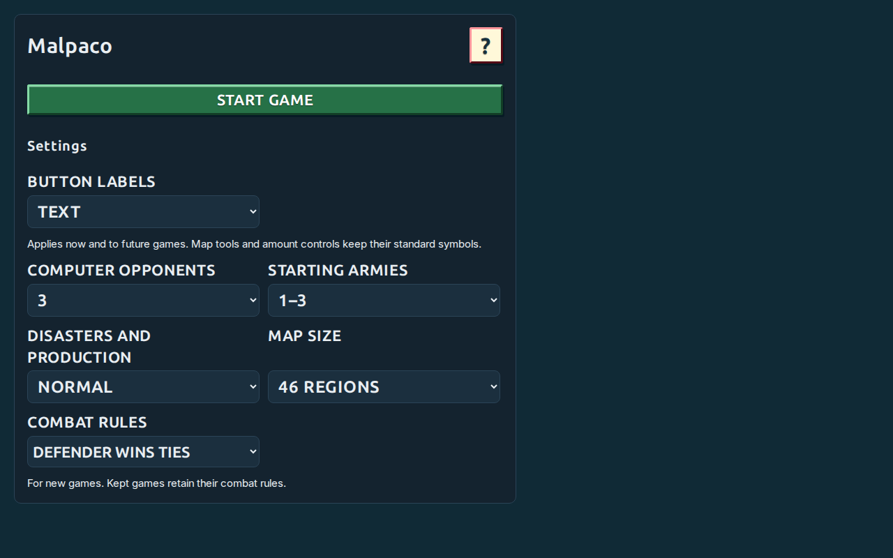
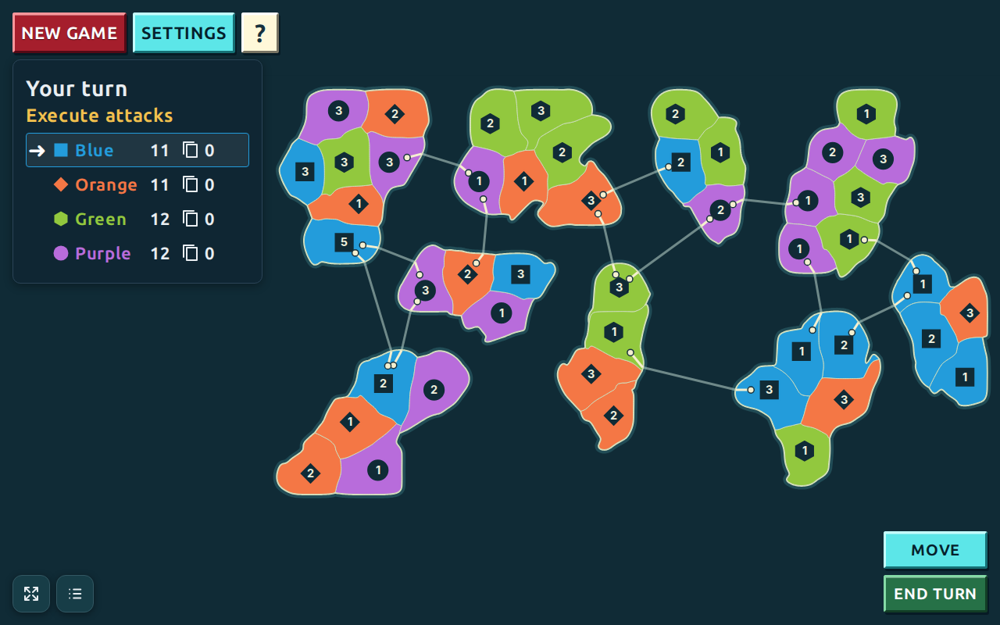
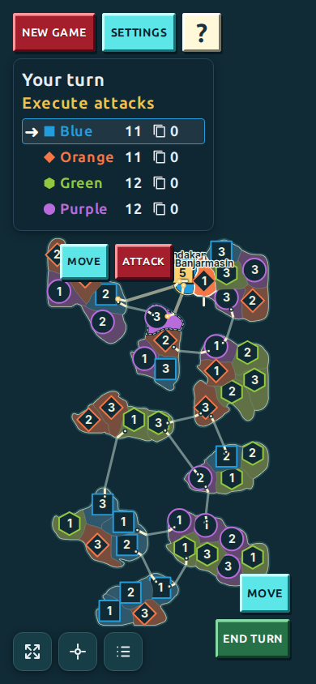
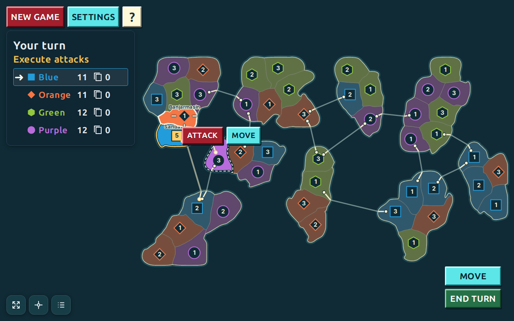
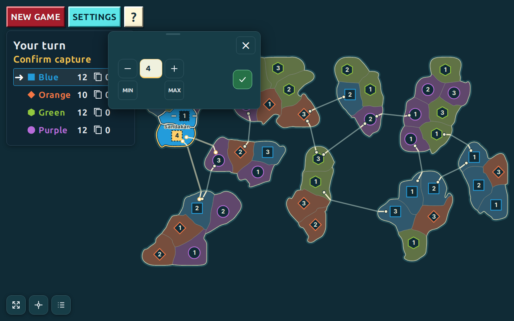
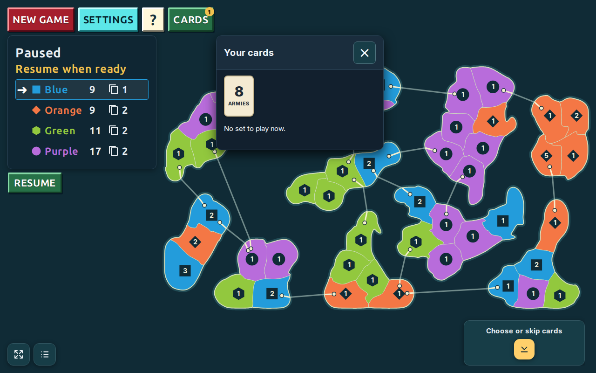
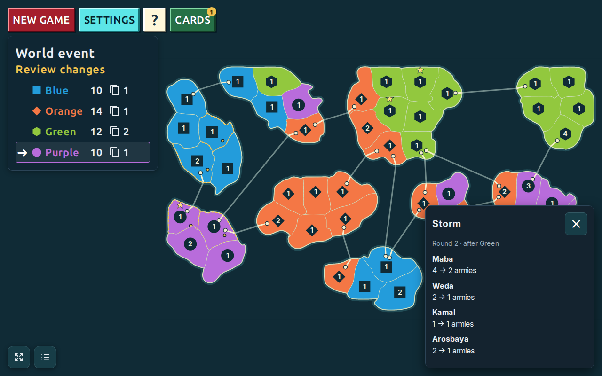
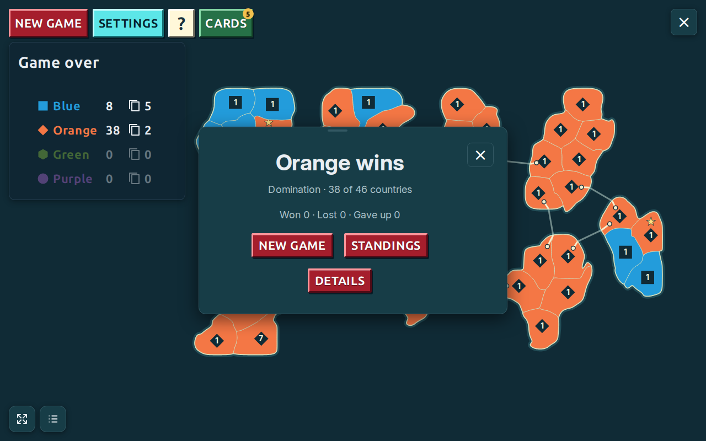

# Malpaco player manual

For **0.5.1 development**, based on the published 0.5.0 web game, with timed event notices, persistent button-label preferences and short-window launcher scrolling. Screenshots show real browser play, including retained games. Their maps, colours and army counts are examples; your game will differ. Read the combat rule and objective in your own game's Help, especially when resuming an older game.

## Your first game

Open [Malpaco](https://malpaco.netlify.app). On a fresh visit, choose your settings and press **Start game**. Changing a setting does not start play. A three-second countdown gives you time to get ready. You play one seat against one to three computers; the other seats are named Orange, Green and Purple.

If a game is already kept in this browser, press **Resume saved game**. Resume keeps its map, armies, cards, rules and pending choices; it skips the countdown. **New game** on the launcher opens settings for a new match. During play, New game first asks whether to give up the current match.

*Start game is above the settings. Very short windows scroll the whole launcher card; taller windows scroll only the settings region.*

## Settings for your next game

| Setting | Choices and effect |
| --- | --- |
| Button labels | Text (default) or Icons. This display choice applies immediately to the launcher and running game, and is kept across turns, new games, reloads and screen sizes. |
| Computer opponents | 1, 2 or 3; default 3. You control one seat in normal play. |
| Starting armies | 1–2, 1–3 or 1–4 armies per country; default 1–3. All seats use the same range, with balanced aggregate budgets apart from unavoidable integer differences. |
| Disasters and production | Off, Rare, Normal or Often; default Normal. Off removes world events and production-centre stars. |
| Map size | 46, 72 or 96 regions; default 46. Larger maps add islands and use numbered territory names. |
| Combat rules | Defender wins ties (default), or Legacy (reroll ties). Applies to a new match. |

Settings during play pauses the game. **Button labels take effect immediately** and do not change match rules or actions. The other choices apply only to the next game. Return to the map to continue the current match, or choose New game to use the new setup. Help reports the running game's combat rule even when a different rule is selected for the next game. The ordinary launcher picks a new seed; seed and choices determine the initial map and deal, and the same actions reproduce its dice sequence.

## Read the map and controls

Each country has an owner colour and an army count. Land borders and drawn sea links tell you which countries are adjacent; visual closeness across water does not create a route. A star marks a production centre while events are enabled. Country names and geography come from the seed; names have no rule effect.

The turn tracker lists seats, public counts and the current player's arrow. Wait until the arrow reaches your colour and the guidance says it is your turn. The tracker tells you whether to place armies, attack or move. Computer placements, battles and transfers are shown before play passes on.

*The arrow and guidance identify who can act. The map shows ownership, armies, borders and sea links. Stars appear in the event example below.*

| Control | Use |
| --- | --- |
| New game | Ask to give up, show the result, then configure a new match. |
| Settings | Change next-game choices or open the scoreboard; pauses play. |
| Help / ? | Read the current objective, combat rule, controls and these instructions; pauses play. |
| Cards | Open your hand when you hold cards; the badge is your card count. |
| Fit | Restore a view of the whole map. |
| Countries | List countries by island; filters show countries usable for the current action. Inspect an entry for owner, armies and neighbours. |
| Resume | Continue after an explicit pause or interruption. |

Pinch or use the mouse wheel to zoom; drag to pan. Use Fit if you lose your place. If a tap overlaps two countries, choose from the list. Country selection and action controls also work with keyboard focus and Enter/Space; Shift activation selects without immediately fighting an armed attack. Form controls retain their ordinary keyboard behavior.

Choose **Text** or **Icons** under Button labels on the start screen or in Settings. The game keeps your choice instead of changing faces during play or when you resize. Text is the default, and labels/padding scale down for smaller screens. In Icons mode, play starts/resumes, the flag ends a turn, crossed weapons attack and arrows move. Map tools, amount controls and Close keep their standard symbols in both modes; the check mark confirms amounts. Accessible names and tooltips keep action names. Country names, counts and form labels stay as text. Rotate or zoom for dense boards. In very short windows, the whole launcher card scrolls. Start/Resume come first; scroll back to the top to reach them. Keyboard focus brings each setting and its label into view together. Taller launchers scroll only their settings region.

*The phone uses the same rules and actions. Text labels shrink with the screen; choose Icons if you prefer compact symbols.*

## A turn, from cards to handoff

1. **Cards:** if a playable set is offered, choose one or Skip. Resolve any required discard or army-reduction target before placement.
2. **Place armies:** tap your own countries to add one army per tap from the displayed pool. The last placement starts combat automatically in the normal player game.
3. **Attack:** choose a source and an adjacent enemy, then use Attack for one exchange at a time. You may change sources or stop attacking.
4. **Capture:** after taking a country, choose its move-in amount and confirm before doing anything else.
5. **Move or finish:** optionally make one adjacent friendly transfer; confirming it ends the turn. Otherwise choose End turn.
6. **Reward and events:** capturing at least one country can earn a card at turn end. A world event may follow. Informational notices close after three seconds of unpaused play, then the next seat proceeds.

New games receive **max(2, floor(countries owned ÷ 3))** armies plus bonuses for islands completely owned. Eight countries give two base armies; nine give three. Partial island control gives no island bonus; bonuses for several complete islands add together. Older kept matches retain their original income rules.

Place the pool where you intend to defend or attack. A country must keep at least one army after a transfer. A large enemy stack does not make an attack illegal: two armies at the source are enough to attempt a normal-game attack. Conservative guidance comparisons are advice, not a strength gate.

## Attack one exchange at a time

Select your country, then an adjacent enemy. Selecting that enemy only stages the target. Press **Attack** beside your source to fight one exchange, and press again to continue. Alternatively, press Attack before choosing a target: this arms the source, and the next eligible enemy tap fights one exchange. Human attacks do not continue automatically.

The source needs at least two armies. Each side rolls one six-sided die; the lower roll loses one army. With **Defender wins ties**, equal rolls cost the attacker one army. With **Legacy**, equal rolls reroll until decisive. You may stop, change targets or end the turn. A source reduced to one army stays yours but cannot attack until reinforced.

*Selecting a target highlights the pair. Attack resolves one exchange; selection alone does not commit a battle unless the source was already armed.*

Your source has a gold outline; eligible targets have light dashed outlines, and the chosen target has a light outline and a crosshair around its count. These markers and routes help distinguish targets without relying only on colour. If both Attack and Move are possible, both controls appear. Choosing Attack from an unconfirmed friendly-transfer destination cancels the draft without moving armies.

## Capture and friendly movement

When the defender loses its last army, you take the country. Choose the **total** armies to move in from the attacker's remaining stack, leaving at least one behind. **Min**, **Max**, minus and plus change the proposed amount; you can also edit the amount field. Only **Confirm** commits it. Dashed counts show the choice is pending. Closing never confirms it; use the return control to reopen the choice.

*Check the source and destination counts, then use the check mark to confirm the amount.*

For a friendly transfer, select **Move** on a country with more than one army and choose an adjacent country you own, or use Move armies. Choose an amount with the same controls. Cancel abandons the draft. Confirm makes the transfer **and ends your turn**. You get one adjacent friendly move per turn, not a multi-country march. End turn finishes without one.

Cards float above the map. Drag a card by its grip or edge to move it; later cards reuse the position. Double-tap the grip or start a new game to reset it. Drag the hand window by its title.

## Cards: earn, hold and play

Hands start empty. Capture at least one country and finish your turn to earn **one card**, not one per capture. Drawing does not immediately add armies. The draw notice shows your hand and marks the new card; it closes after three seconds of unpaused play or immediately with Close/Continue.

At the start of a later turn, play **at most one set of three** or Skip. All three must be the same playable kind, with up to two Any value cards replacing that kind. Three wild cards alone are not a set. A mixed 5/8/15 trio is not a set.

| Face / label | Effect |
| --- | --- |
| 5 / 5 armies | A set adds 5 armies to this turn's placement pool. |
| 8 / 8 armies | A set adds 8 armies. |
| 15 / 15 armies | A set adds 15 armies. |
| ×2 / Double armies | A set doubles the placement pool. |
| Bomb / Army reduction | A set lets you choose any enemy country, then Confirm. Its stack becomes a random number from 1 to half its previous size, rounded down, with minimum 1. Ownership stays the same. |
| Crossed bomb / Protection | Automatically spent to block one army-reduction effect against its owner's country. Not a playable set. |
| Star / Any value | Replaces one card in a playable set; at least one genuine card of that kind is required. |
| Cards lost | Drawing this special card discards your whole hand. |

*Only your hand is shown. Other seats' counts are public; their card faces are private.*

A hand holds at most **five cards**. If you earn another while full, discard one existing card before seeing the new draw. The Cards button is available on your turn and hides while computers play. Required set/skip, discard and reduction-target choices do not time out. For Army reduction, the card folds so you can select a highlighted enemy on the map or in Countries, then Confirm. Normal single-player games have cards; historical multi-human test games can have different rules.

## Production centres and world events

With events enabled, three countries have stars. These are sites on the map, not permanent bonuses to one seat. Events can help or hurt different owners; they do not target the leader or guarantee a comeback.

| Event | What changes |
| --- | --- |
| Harvest | Each centre gains its current army count or 10, whichever is smaller. A stack of 4 becomes 8; 15 becomes 25. |
| Production centres moved (Shift) | Three sites are selected again; an old site may be retained. Armies and owners do not change. |
| Storm | Reduces a connected group of three or four stacks, keeping each at least 1. |
| Revolt | One eligible border country changes to a neighbouring owner; armies stay the same. It cannot eliminate a seat. |

*The notice lists what changed; map markers identify affected countries.*

Rare, Normal and Often give an event chance of 1 in 21, 14 or 8 at an eligible turn change. Round one, imminent wins, the last three rounds of a round-limit game and the transition following an event are protected. An event can have no effect without an eligible target. Off hides centres and disables event draws.

Storm, revolt, harvest and moved-centre notices **close after three seconds of unpaused play**. Close, Escape or Android Back dismisses immediately. Opening Settings or pausing stops the timeout; resuming gives a fresh three seconds. Menu-folded notices do not expire unseen. Dismissal records that you saw the notice; it does not undo or repeat the event or override a separate pause requiring Resume. Required troop and card decisions stay open until you act.

## Winning, losing and the scoreboard

Normal games use **Domination**: finish your turn holding at least three quarters of the countries, rounded up: **35 of 46**, **54 of 72** or **72 of 96**. Taking all countries also wins. Help's Objective shows the target and your progress. Victory is checked when the turn completes, after required captures/transfers are resolved.

You are eliminated with no countries. The loss screen can offer **Watch computers** to let remaining seats finish or **Stop game** to stop watching. Losing is recorded once even if you keep watching. Giving up is recorded separately.

*The result identifies the winner or your elimination. Open Standings or Details; fold the card to inspect the map.*

The result card folds to a compact chip and reopens. **Standings** shows countries and armies; **Details** includes the seed and match options. Historical round-limit games rank by countries, then armies, then later position in that round's turn order. The ordinary launcher has no round-limit or total-conquest-only switch.

Open the trophy **Scoreboard** in Settings for games played, wins, losses, give-ups, win rate and the last 20 games, newest first. Each game counts once. Rule filters distinguish combat groups; older entries can be Legacy/unspecified. Reset asks before clearing. Scores belong to this browser, not an online ranking.

## Keep and resume your game

Committed actions are saved in this browser. Reloading or returning offers Resume saved game, including pending capture/card decisions. A paused match waits for Resume. Settings and Help pause play while open and normally return to play when closed; neither clears an independent interruption pause. You can inspect and navigate the map while notices or decisions are pending.

There is no account, online multiplayer or cross-device synchronization. Other browsers/devices have separate storage; private browsing is temporary. Clearing site data removes local data. A local server and the hosted game have separate saves. Normal play uses automatic storage, not retired developer Save/Load screens. If the launcher reports a recovery error, use **Download saved data** before clearing anything.

## If something seems stuck

- **No input during computer play:** wait for your colour's arrow. Open Settings or Help to pause and inspect.
- **Cannot attack:** check ownership, at least two armies, an explicit adjacent enemy route and no pending troop/card decision.
- **Amount card returns:** choose a legal amount and Confirm; closing does not commit.
- **Nothing happens after a notice:** look for Resume or another required choice. Timeouts run only during unpaused play.
- **Missing control:** scroll the settings/help region, use Fit, move an overlapping card or rotate the phone. Choose Icons or Text in Settings for your preferred command faces.
- **Different rule:** read Help for the current match. Old kept games retain rules; preferences apply after starting a new match.

## Offline play and manual maintenance

Download the [latest playable archive](https://github.com/diegoami/malpaco/releases/latest), extract it and run `node serve.mjs` in `malpaco-playable` with Node.js 22 or later. Open `http://127.0.0.1:4175`; no package installation is needed. From source, use `npm ci` and `npm run dev`.

This guide is available through **Full player manual** in Help. Text lives in `docs/play.md`; selected illustrations live in `docs/manual-images/` with the owner's explicit exception to rule 6. Other screenshots, logs and the portable copy stay in ignored `artifacts/`.

Run `npm run manual:refresh` to capture the UI, replace selected images and produce `artifacts/player-manual/index.html` plus a provenance manifest. Open that HTML directly for an offline illustrated copy. Review pictures and captions before committing. Gameplay, labels, controls, settings and persistence changes must update this guide and Help in the same PR and refresh affected pictures. Keep the documented version/feature heading accurate. Historical release records remain immutable. See `docs/manual-maintenance.md` for the inventory and checks.
