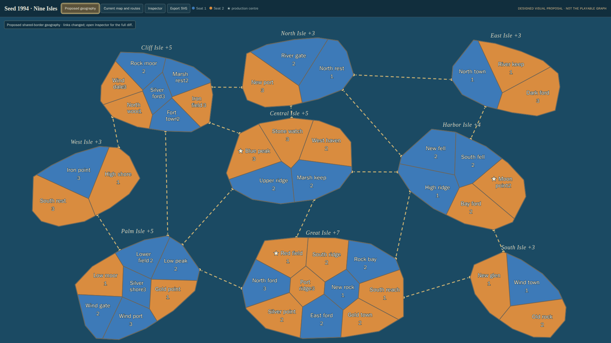
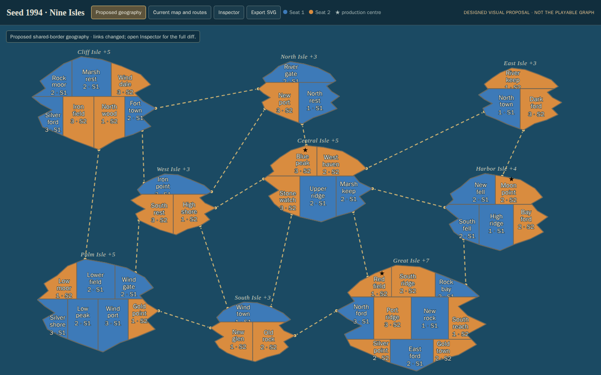
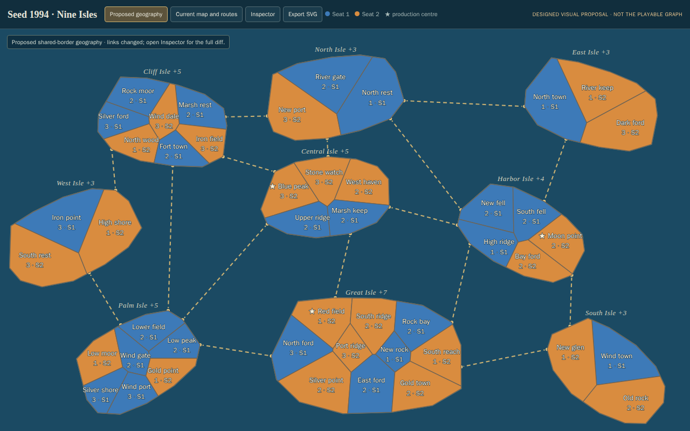
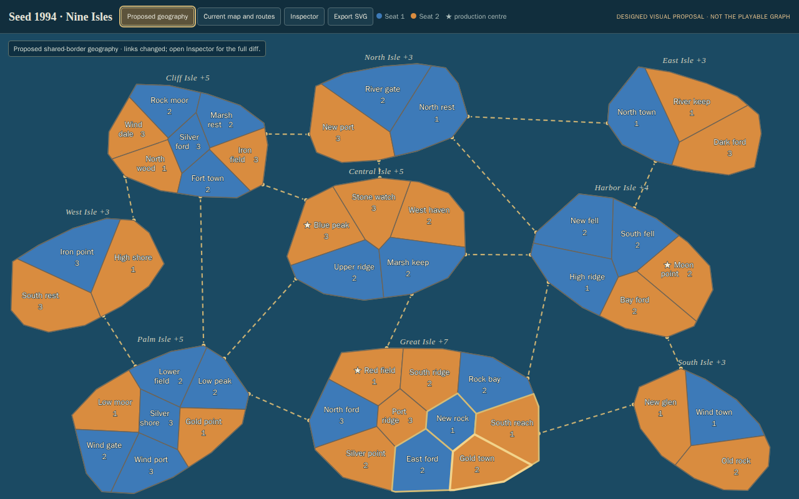

# Seed 1994 map prototype

This directory holds a visual prototype for owner judgment. `preview.html` is
the eventual self-contained file opened directly with `file://`; the source
prototype and geometry builder are kept as a disposable fixture until the
parent's pinned-browser baseline and mutation checks finish. The builder emits
one HTML file with embedded SVG data, styles and interactions. It has no
runtime or build dependencies.

The proposed map uses deterministic, hand-designed island placement and
Voronoi province tiling clipped to broad, varied island silhouettes. Those
positions and the new travel graph are `[designed]` for this seed after
searching the supplied current map and the archived Malpaco Godot demo. The
prototype keeps the 46 source province ids and names, 9 island ids/names and
bonuses, opening owners and armies, and production-centre markers. It replaces
the original map geometry and adjacency only in this display candidate.

This is an explicit topology proposal, not a preservation claim: the current
seed graph has 61 land and 16 sea edges; this proposed geometry has 69 land and
16 sea edges, with some province degrees reaching 6. The net increase of eight
does not identify the changed edges; the inspector lists every addition and
removal by country name. Those exact changes require owner review. Edge counts
do not establish strategic balance, correctness, or preservation of the
playable graph.

The proposed sea lanes retain F's exact 16 country pairs. Each endpoint is the
arc-length midpoint of the exposed coast chain of its province that faces the
linked island; the verifier recomputes this point from the province and island
polygons. The builder refuses the retained route set if these centered coastal
attachments cross unrelated land.

Open the preview and use **Current generated map** and **Proposed geography**
to compare the source geometry with the proposed map. The candidate banner and
topology list disclose all land and sea changes. Select any country to inspect
the exact proposed neighbourhood. **Export SVG** downloads the current map as
a standalone SVG.

The parent session owns candidate replay and browser checks. Run the complete
baseline/candidate/selected-neighbour mutation/restoration sequence with a new
evidence directory:

```sh
node docs/prototypes/map-1994/replay.mjs docs/prototypes/map-1994/preflight-20261015-g
```

The replay installs the candidate's exact bytes only while the pinned-browser
verifier runs, removes the selected-neighbour behavior for the mutation run,
restores and hashes the exact candidate bytes, and returns the checkout to its
original missing-preview state. The verifier opens `preview.html` directly,
checks both required viewport sizes, saves SVG and before/after captures,
validates exact topology differences and geometry, and records feasibility and
the Iron-point/Silver-shore ambiguity. A missing `preview.html` is an
acceptance failure by design.

## Preflight evidence

`preflight-20261015-a/PROVENANCE.md` identifies each supplied JSON input and
its SHA-256. Its exhaustive rotation-system probe independently confirms that
Cliff Isle and Great Isle's land graphs are non-planar while the other seven
are planar. This limits which original land edges can be represented as
shared borders in one plane; any graph changes remain explicit display
proposals.

## First drafts archive

These drafts are retained for comparison even if discarded. They are not approved
production maps. Download an HTML file and open it locally for interaction.

- [Draft A](fixtures/candidate-a/preview.html)
- [Draft B](fixtures/candidate-b/preview.html)
- [Draft C](fixtures/candidate-c/preview.html)
- [Draft D](fixtures/candidate-d/preview.html)
- [Draft E](fixtures/candidate-e/preview-e.html)
- [Draft F](fixtures/candidate-f/preview-f.html)
- [Draft G](fixtures/candidate-g/preview-g.html)

### Draft F screenshots

Regenerated from committed F after the temporary worktree disappeared. The
original F captures were not committed and could not be recovered; these are
a new replay, with its own acceptance and mutation reports alongside them.




### Earlier screenshots






